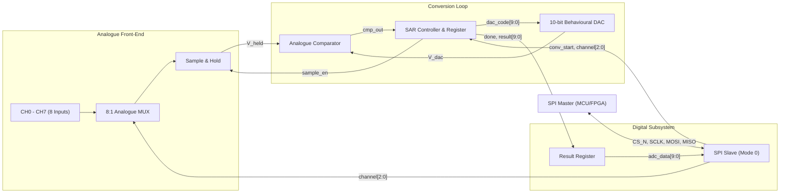
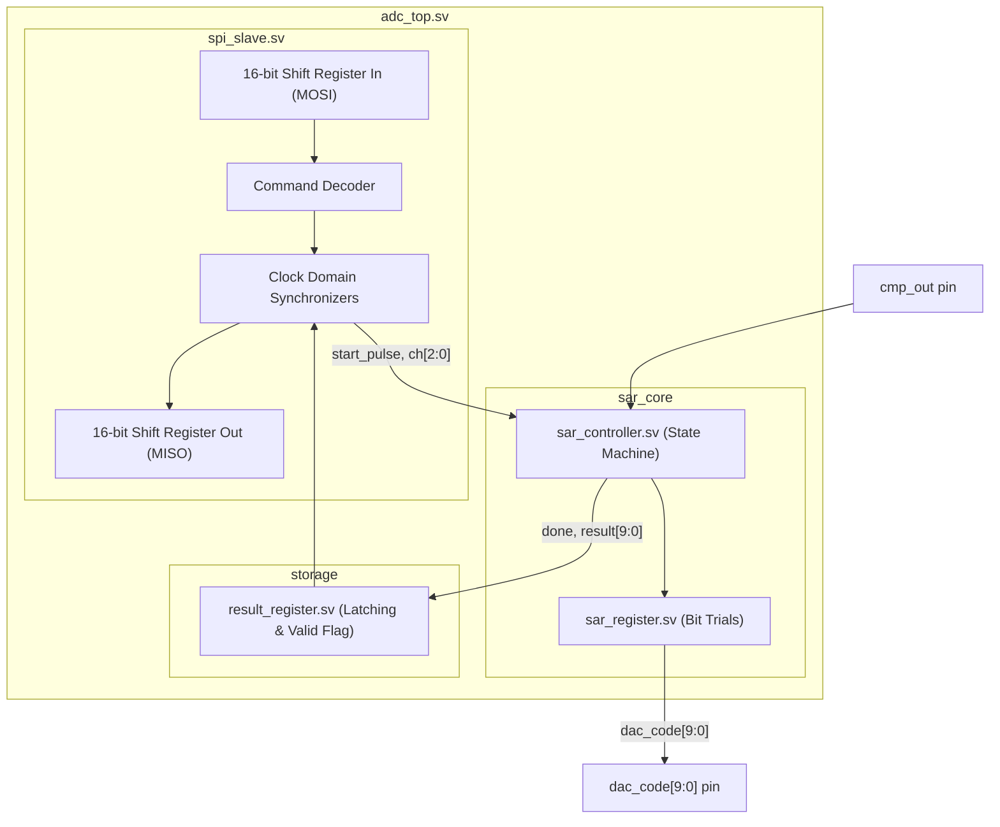

# Architecture: Educational 10-Bit, 8-Channel SAR ADC IC

## 1. Top-Level Architectural Overview

The educational mixed-signal SAR ADC comprises an 8-channel analogue front-end, a 10-bit binary-search conversion loop, and a digital SPI communications engine.

---

## 2. Subsystem Functional Descriptions

### 2.1 Analogue Subsystem (Behavioural Models)
1. **Analogue Input Multiplexer (`adc_mux`):**
   - Routes one of eight external voltages `ch[0]` through `ch[7]` to `mux_out` based on the 3-bit binary channel select vector `channel_sel[2:0]`.
   - Rejects or clips invalid configurations.
2. **Sample-and-Hold (`sample_hold`):**
   - Controlled by `sample_en`.
   - When `sample_en == 1` (Track mode), the internal sampling capacitor tracks `mux_out`.
   - When `sample_en == 0` (Hold mode), the held voltage $V_{\text{held}}$ is isolated and held constant throughout the 10 binary trial cycles.
3. **10-Bit Digital-to-Analogue Converter (`dac_model`):**
   - Accepts 10-bit digital vector `dac_code[9:0]` from the SAR controller.
   - Computes $V_{\text{DAC}} = V_{\text{REF}} \times (D_{\text{trial}} / 1024.0)$.
   - Monotonic and linear in ideal mode, with hooks for integral/differential non-linearity extensions.
4. **Comparator (`comparator`):**
   - Computes differential analogue threshold: $\Delta V = V_{\text{held}} - V_{\text{DAC}}$.
   - Produces digital output `cmp_out`:
     - $\text{cmp\_out} = 1$ if $V_{\text{held}} \ge V_{\text{DAC}}$.
     - $\text{cmp\_out} = 0$ if $V_{\text{held}} < V_{\text{DAC}}$.

---

## 3. Digital RTL Subsystem

### 3.1 Digital Hierarchy
- `rtl/adc_top.sv`: Top-level integration and port mapping.
  - `rtl/sar_controller.sv`: 12-state FSM governing conversion sequence.
  - `rtl/sar_register.sv`: Successive approximation bit trial and accumulation logic.
  - `rtl/result_register.sv`: Output holding register with conversion tag.
  - `rtl/spi_slave.sv`: 16-bit SPI Mode 0 peripheral with CDC logic.
  - `rtl/adc_config.sv`: System-wide constants, parameters, and types.

### 3.2 Clocking and Reset Structure
- **Core Clock (`clk`):** Free-running internal clock driving the SAR state machine and result register.
- **Serial Clock (`sclk`):** Asynchronous external SPI clock driven by the bus master.
- **Clock Domain Crossing (CDC):** Dual-flip-flop synchronizers and edge-detect logic interface the SCLK domain with the system `clk` domain, guaranteeing race-free and deterministic handshakes.
- **Reset (`rst_n`):** Active-low asynchronous reset with synchronous deassertion. Initializes all registers, state machines, and status flags.

---

## 4. Pinout and Signal Definitions

| Port Name | Direction | Domain | Description |
|---|---|---|---|
| `clk` | Input | Digital | ADC core clock |
| `rst_n` | Input | Digital | Active-low asynchronous reset |
| `cs_n` | Input | SPI | SPI chip select (active low) |
| `sclk` | Input | SPI | SPI serial clock (Mode 0) |
| `mosi` | Input | SPI | Master Out Slave In |
| `miso` | Output | SPI | Master In Slave Out (tri-state when `cs_n=1`) |
| `sample_en` | Output | Analogue | Sample (1) / Hold (0) control |
| `channel_sel[2:0]` | Output | Analogue | Channel multiplexer address |
| `dac_code[9:0]` | Output | Analogue | Digital trial code to DAC |
| `cmp_out` | Input | Analogue | Comparator binary decision |
| `busy` | Output | Digital | Conversion in progress |
| `conv_done` | Output | Digital | Single-cycle completion strobe |
| `result_data[9:0]`| Output | Digital | Latest stable 10-bit result |

