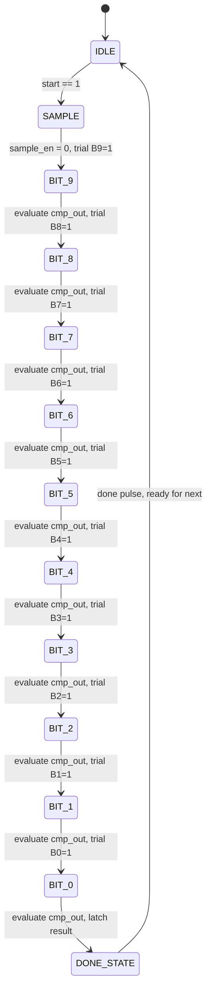

# Block Diagrams and Signal Routing

## 1. Complete System Architecture

```text
               +-------------------------------------------------------------+
               |                  Educational SAR ADC Top Level             |
               |                                                             |
   CH0 --------+-->[ MUX 8:1 ]                                               |
   CH1 --------+        |                                                    |
   CH2 --------+        | mux_out                                            |
   CH3 --------+        v                                                    |
   CH4 --------+-->[ S/H Unit ]-- V_held --(+)                               |
   CH5 --------+        ^                   |                                |
   CH6 --------+        | sample_en         v                                |
   CH7 --------+        |             [ Comparator ]<-- cmp_out              |
               |        |                   ^                |               |
               |        |                   | V_dac          |               |
               |        |             [ 10-bit DAC ]         |               |
               |        |                   ^                |               |
               |        |                   | dac_code[9:0]  v               |
               |   +----+-------------------+-----------+----+-----------+   |
               |   |                                    |                |   |
               |   |         SAR Controller & FSM       |                |   |
               |   |                                    |                |   |
               |   +----+-------------------------------+---+-----------+   |
               |        |                                   |                |
               |        | done                              | bit_ptr[3:0]   |
               |        v                                   v                |
               |   [ Result Register ]                 [ Status Logic ]      |
               |        |                                   |                |
               |        +-----------------+-----------------+                |
               |                          |                                  |
               |                          v                                  |
               |                  [ SPI Slave Core ]                         |
               |                          |                                  |
               +--------------------------+----------------------------------+
                                          |
                CS_N  <-------------------+ (Chip Select, Active Low)
                SCLK  <-------------------+ (Serial Clock, Mode 0)
                MOSI  <-------------------+ (Master Out Slave In)
                MISO  ------------------->+ (Master In Slave Out)
```

## 2. SAR Controller Finite State Machine (FSM)



## 3. Clock and Reset Domains

- **Asynchronous Global Reset (`rst_n`):** Direct asynchronous clear to all registers; active low.
- **Synchronous Core Clock (`clk`):** Drives SAR state machine, trial register, result register, and CDC logic.
- **Serial Clock (`sclk`):** Driven externally by SPI master. Samples MOSI on rising edges; shifts MISO on falling edges. Dual-rank synchronizers interface SCLK control strobes with the system `clk`.

