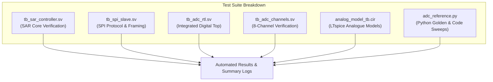

# Verification Plan and Test Strategy

## 1. Overview and Objectives

The verification strategy guarantees that:
1. The digital RTL (SAR controller, register, result register, and SPI slave) is 100% compliant with the functional specification.
2. The analogue behavioural models accurately reflect the physical transfer functions of their blocks.
3. System integration between digital control, channel selection, and data readout is proven end-to-end.
4. An independent Python reference model verifies every digital output code (0 to 1023) and voltage boundary conditions.

---

## 2. Test Suites and Scopes

---

## 3. Detailed Test Matrix

| Test Suite | Module Under Test | Key Test Cases | Pass/Fail Criteria |
|---|---|---|---|
| **`tb_sar_controller`** | `sar_controller.sv` | • Zero input ($D=0$) • 1 LSB ($D=1$) • Quarter-scale ($D=256$) • Half-scale ($D=512$) • Three-quarter-scale ($D=768$) • Full-scale ($D=1023$) • Transition threshold voltages • Asynchronous reset during conversion • Request while busy rejection • Exact 11-cycle timing | All 10-bit output codes match golden reference; state machine does not lock up; busy/done strobes assert correctly. |
| **`tb_spi_slave`** | `spi_slave.sv` | • Mode 0 CPOL=0, CPHA=0 timing • Active LOW CS_N assertion • Tri-state MISO when CS_N=1 • 16-bit command decoding (Start bit, Channel address, Auto-start) • Invalid command rejection • Premature CS_N deassertion (frame abort) • Back-to-back transactions | Transmitted MISO frame matches expected bits; error flag asserts on malformed frames; channel tag matches. |
| **`tb_adc_rtl`** | `adc_top.sv` | • Full digital top-level integration • SPI-driven conversions with behavioural comparator feedback • Latched result stability across multiple transactions | Conversion requests over SPI complete and return accurate codes. |
| **`tb_adc_channels`** | `adc_top.sv` | • Channels CH0 through CH7 tested with distinct voltages • Dynamic channel switching between successive conversions • Verify no channel crosstalk or stale data returned | Each channel returns only its assigned conversion value. |
| **`analog_model_tb`** | `tb/analog/*.cir` | • 8:1 MUX address routing • S&H track and hold settling • 10-bit DAC transfer curve and monotonicity • Comparator switching across $V_{\text{DAC}} \pm 1\,\text{mV}$ | SPICE node voltages match theoretical calculations within 0.1% tolerance. |
| **`adc_reference.py`** | `models/adc_reference.py` | • Exhaustive test of all 1024 codes • Quantization threshold boundaries • Reproducible pseudo-random inputs ($N=1000$, fixed seed 42) • Configurable non-idealities (offset, gain error, noise) | 0 bit errors against theoretical transfer function $D = \min(1023, \lfloor 1024 \cdot V_{\text{IN}} / V_{\text{REF}} \rfloor)$. |

